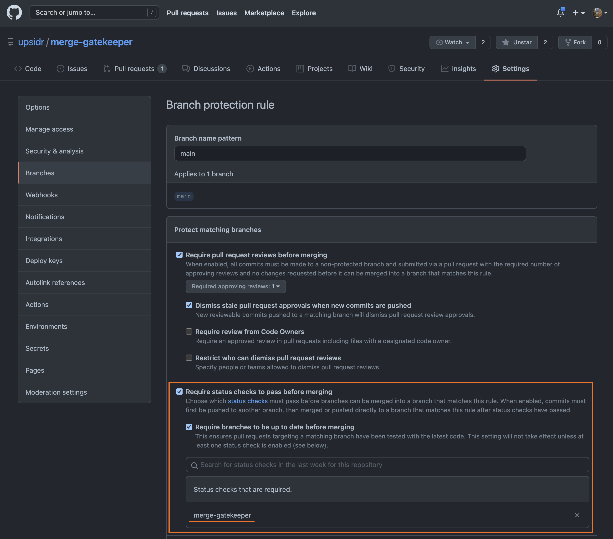

# Merge Gatekeeper

Merge Gatekeeper provides extra control for Pull Request management.

## 🌄 What Does Merge Gatekeeper Provide, and Why?

<!-- == imptr: background / begin from: ./docs/details.md#[background] == -->

Pull Request plays a significant part in day-to-day development, and it is essential to ensure all merges are well controlled and managed to build robust system. GitHub provides controls over CI, reviews, etc., but there are some limitations around handling specific use cases. Merge Gatekeeper helps overcome those by adding extra controls, such as monorepo friendly branch protection.

At UPSIDER, we have a few internal repositories set up with a monorepo structure, with many types of code in a single repository. This comes with its own pros and cons, but one difficulty is how we end up with various CI jobs, which only run for changes that touch relevant files. With GitHub's branch protection, there is no way to specify "Ensure Go build and test pass _if and only if_ Go code is updated", or "Ensure E2E tests are run and successful _if and only if_ frontend code is updated". This is due to the GitHub branch protection design to specify a list of jobs to pass, which is only driven by the target branch name, regardless of change details. Because of this limitation, we would either need to run all the CI jobs for any Pull Requests, or do not set any limitation based on the CI status. <sup><sub><sup>(\*1)</sup></sub></sup>

**Merge Gatekeeper** was created to provide more control for merges. By placing Merge Gatekeeper to run for all PRs, it can check all other CI jobs that get kicked off, and ensure all the jobs are completed successfully. If there is any job that has failed, Merge Gatekeeper will fail as well. This allows merge protection based on Merge Gatekeeper, which can effectively ensure any CI failure will block merge. All you need is the Merge Gatekeeper as one of the PR based GitHub Action, and set the branch protection rule as shown below.



We are looking to add a few more features, such as extra signoff from non-coder, label based check, etc.

<sup><sub>NOTE:  
<sup>(\*1)</sup> There are some other hacks, such as using an empty job with the same name to override the status, but those solutions do not provide the flexible control we are after.</sub></sup>

<!-- == imptr: background / end == -->

You can find [more details here](/docs/details.md).

## 🚀 How Can I Use Merge Gatekeeper?

<!-- == imptr: example-usage / begin from: ./docs/action-usage.md#[simple-usage] == -->

The easiest approach is to copy the standard definition, and save it under `.github/workflows` directory. There is no further modification required unless you have some specific requirements.

#### With `curl`

```bash
curl -sSL https://raw.githubusercontent.com/upsidr/merge-gatekeeper/main/example/merge-gatekeeper.yml \
  > .github/workflows/merge-gatekeeper.yml
```

#### Directly copy YAML

The below is the copy of [`/example/merge-gatekeeper.yml`](/example/merge-gatekeeper.yml), with extra comments.

<!-- == imptr: basic-yaml / begin from: ../example/definitions.yaml#[standard-setup] wrap: yaml == -->
```yaml
---
name: Merge Gatekeeper

on:
  pull_request:
    branches:
      - main
      - master

jobs:
  merge-gatekeeper:
    # The cheapest runner is enough: the job mostly waits. ubuntu-slim jobs are
    # stopped after 15 minutes, so use ubuntu-latest if you raise `timeout`
    # (default 10 minutes) close to that.
    runs-on: ubuntu-slim
    # Restrict permissions of the GITHUB_TOKEN.
    # Docs: https://docs.github.com/en/actions/using-jobs/assigning-permissions-to-jobs
    permissions:
      actions: read # Tells jobs with the same name in different workflows apart.
      checks: read
      statuses: read
    steps:
      - name: Run Merge Gatekeeper
        # NOTE: For supply-chain safety, pin to a commit SHA and keep the version
        #       tag in a trailing comment, e.g. `@<commit SHA> # v2.0.0`.
        #       https://github.com/upsidr/merge-gatekeeper/tags
        #       https://github.com/upsidr/merge-gatekeeper/branches
        uses: upsidr/merge-gatekeeper@v2
        with:
          token: ${{ secrets.GITHUB_TOKEN }}
```
<!-- == imptr: basic-yaml / end == -->

<!-- == imptr: example-usage / end == -->

You can find [more details here](/docs/action-usage.md).

## 🏃 Runner Requirements

<!-- == imptr: runner / begin from: ./docs/action-usage.md#[runner] == -->

Merge Gatekeeper is a JavaScript action that runs on the `node24` runtime bundled with the GitHub Actions runner. It does not need Docker, and it does not need `actions/checkout` or `actions/setup-node`.

- **We recommend `runs-on: ubuntu-slim`.** The job mostly waits for other jobs and only makes a few API calls, so the [single-CPU Linux runner](https://docs.github.com/en/actions/reference/runners/github-hosted-runners#single-cpu-runners) (1 vCPU, 5 GB RAM, runs in a container) is enough. In private repositories it is billed at a third of the standard Linux runner ([pricing](https://docs.github.com/en/billing/reference/actions-runner-pricing)); in public repositories both are free. v1, a Docker container action, was not a fit for it: `ubuntu-slim` runs in an unprivileged container without Docker-in-Docker support.
- **`ubuntu-slim` jobs are stopped after 15 minutes.** Keep `initial-delay` plus `timeout` well below that; the defaults (no delay, `timeout: 600`) fit. If your other jobs take longer than about 14 minutes, use `runs-on: ubuntu-latest` instead, which has the usual 6-hour job limit.
- macOS and Windows runners also work, but they are billed at a higher rate for the same wait.
- **Self-hosted runners** must run a version of the Actions runner that supports `node24` actions. Docker is not required, so runners inside containers or without Docker access work as well.
- **GitHub Enterprise Server** is supported. The API endpoint is taken from `GITHUB_API_URL`, which the runner sets automatically.
- **Network access** to the GitHub REST API (`api.github.com`, or your Enterprise Server API) is the only outbound connection Merge Gatekeeper makes. If the runner reaches it through a proxy, `HTTPS_PROXY` / `HTTP_PROXY` and `NO_PROXY` (upper or lower case) are honoured. This needs the `node24` runtime of Actions runner with Node.js 24.14 or later; on older runners, set `NODE_USE_ENV_PROXY: 1` in the job `env`.

<!-- == imptr: runner / end == -->

## 🔑 Token Permissions

<!-- == imptr: permissions / begin from: ./docs/action-usage.md#[permissions] == -->

| Permission       | Needed for                                                                                                                                   |
| ---------------- | -------------------------------------------------------------------------------------------------------------------------------------------- |
| `checks: read`   | Required. Reads check runs, which include GitHub Actions jobs.                                                                               |
| `statuses: read` | Required. Reads commit statuses.                                                                                                             |
| `actions: read`  | Recommended. Tells jobs with the same name in different workflows apart ([#60](https://github.com/upsidr/merge-gatekeeper/issues/60)). |

Without `actions: read`, a private repository cannot read which workflow a job belongs to. Merge Gatekeeper then shows a warning and treats jobs with the same name as one job, where only the latest run counts. Public repositories can read it without the permission. See [how it works](/docs/details.md#how-does-merge-gatekeeper-work) for details.

<!-- == imptr: permissions / end == -->

## 🆕 Upgrading from v1

<!-- == imptr: upgrade / begin from: ./docs/action-usage.md#[upgrade] == -->

Change `upsidr/merge-gatekeeper@v1` to `@v2`. The inputs and their defaults are unchanged.

What changes in v2:

- It runs as a JavaScript action, without Docker. There is no image to pull and no build step. See [why](/docs/details.md#why-is-merge-gatekeeper-a-javascript-action).
- Commits with 100 or more commit statuses no longer cause a timeout ([#98](https://github.com/upsidr/merge-gatekeeper/issues/98)).
- A completed check run that has no conclusion yet is treated as still running, instead of crashing.
- GitHub Enterprise Server is supported through `GITHUB_API_URL` ([#74](https://github.com/upsidr/merge-gatekeeper/issues/74)).

If you use a self-hosted runner, check that it supports `node24` actions before upgrading.

<!-- == imptr: upgrade / end == -->

### Why JavaScript?

<!-- == imptr: why-javascript / begin from: ./docs/details.md#[why-javascript] == -->

Up to v1, Merge Gatekeeper was a Docker container action written in Go. Every run pulled the `golang` image from Docker Hub and compiled the binary from the `Dockerfile` before it could start checking anything. v2 is a rewrite as a JavaScript action, for these reasons:

- **The job did almost no work, but paid for a full build.** All Merge Gatekeeper does is call two GitHub REST endpoints and compare the results. Pulling a Go toolchain image and compiling on every PR added a noticeable delay to every run, for a few hundred lines of logic.
- **Docker was the most common source of problems.** Users hit Docker Hub rate limits ([#69](https://github.com/upsidr/merge-gatekeeper/issues/69)), `docker build` failures on self-hosted runners ([#72](https://github.com/upsidr/merge-gatekeeper/issues/72)), and runners where Docker is not available at all ([#75](https://github.com/upsidr/merge-gatekeeper/issues/75)). None of these had anything to do with merge control.
- **The runner already has everything needed.** The GitHub Actions runner ships with Node.js for JavaScript actions, and Node.js has `fetch` built in. The action therefore has no dependencies: no `node_modules`, and no bundled `dist/` file.
- **What you read is what runs.** Because there is no build step and no third-party package, the JavaScript in this repository is exactly the code that runs in your workflow. This makes it easy to review and to pin by commit SHA, and there are no dependency updates to keep up with.

Inputs and their defaults stay the same as v1, so switching from `@v1` to `@v2` needs no other change in most workflows.

<!-- == imptr: why-javascript / end == -->

## 🧪 Action Inputs

There are some customisation available for Merge Gatekeeper.

<!-- == imptr: inputs / begin from: ./docs/action-usage.md#[inputs] == -->

| Name       | Description                                                                                                                                                                                                                                                                                          | Required |
| ---------- | ---------------------------------------------------------------------------------------------------------------------------------------------------------------------------------------------------------------------------------------------------------------------------------------------------- | :------: |
| `token`    | `GITHUB_TOKEN` or Personal Access Token with `repo` scope                                                                                                                                                                                                                                            |   Yes    |
| `self`     | The name of Merge Gatekeeper job, and defaults to `merge-gatekeeper`. This is used to check other job status, and do not check Merge Gatekeeper itself. If you updated the GitHub Action job name from `merge-gatekeeper` to something else, you would need to specify the new name with this value. |          |
| `interval` | Check interval to recheck the job status. Default is set to 5 (sec). Accepts seconds (`30`) or a duration (`30s`, `1m`). Must be at least 1 second.                                                                                                                                                 |          |
| `timeout`  | Timeout setup to give up further check. Default is set to 600 (sec). Accepts seconds (`600`) or a duration (`10m`, `1h30m`).                                                                                                                                                                          |          |
| `initial-delay` | Delay before the first validation. Useful when other jobs are known to take a while, to avoid needless polling at the start. This delay is not counted towards `timeout`. Default is set to 0 (sec). Accepts seconds or a duration (`1m`).                                                     |          |
| `ignored`  | Jobs to ignore regardless of their statuses. Defined as a comma-separated list.                                                                                                                                                                                                                      |          |
| `ref`      | Git ref to check. This defaults to the HEAD for given PR. When that is empty, such as on `push` events, it falls back to the commit that triggered the workflow (`GITHUB_SHA`). Can be set to any ref.                                                                                                 |          |

<!-- == imptr: inputs / end == -->

You can find [more details here](/docs/action-usage.md).
