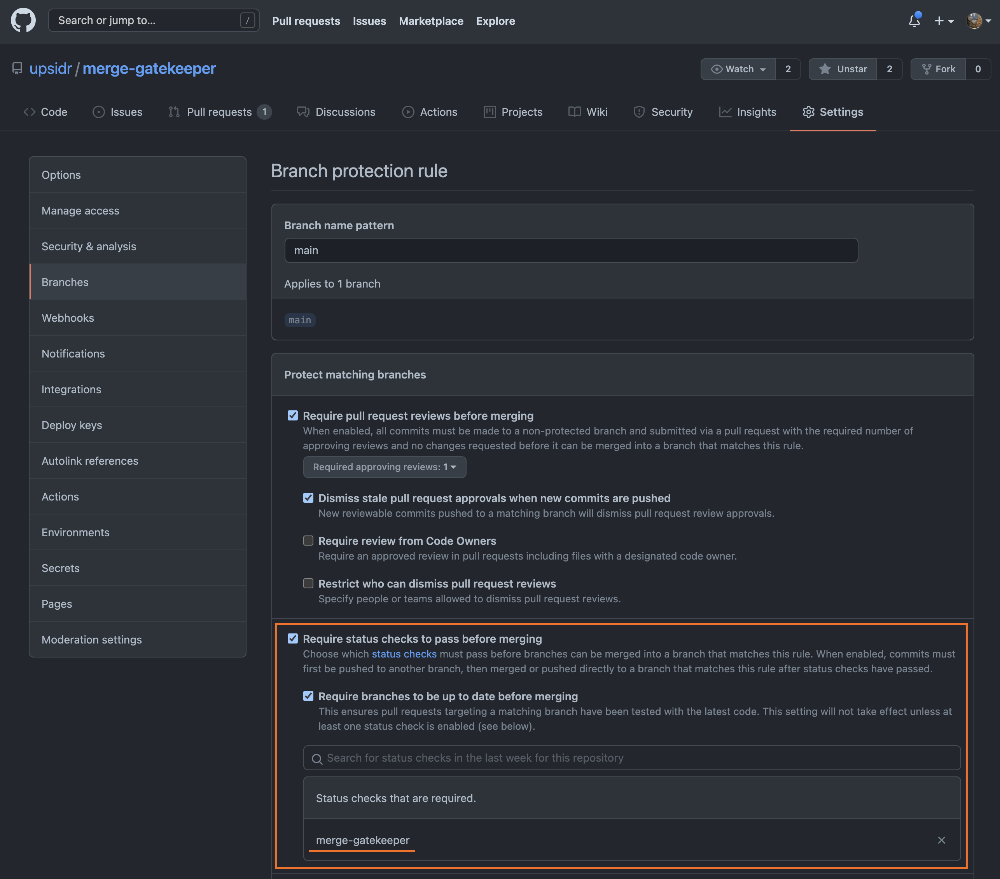

# Details of Merge Gatekeeper

## Background

<!-- == export: background / begin == -->

Pull Request plays a significant part in day-to-day development, and it is essential to ensure all merges are well controlled and managed to build robust system. GitHub provides controls over CI, reviews, etc., but there are some limitations around handling specific use cases. Merge Gatekeeper helps overcome those by adding extra controls, such as monorepo friendly branch protection.

At UPSIDER, we have a few internal repositories set up with a monorepo structure, with many types of code in a single repository. This comes with its own pros and cons, but one difficulty is how we end up with various CI jobs, which only run for changes that touch relevant files. With GitHub's branch protection, there is no way to specify "Ensure Go build and test pass _if and only if_ Go code is updated", or "Ensure E2E tests are run and successful _if and only if_ frontend code is updated". This is due to the GitHub branch protection design to specify a list of jobs to pass, which is only driven by the target branch name, regardless of change details. Because of this limitation, we would either need to run all the CI jobs for any Pull Requests, or do not set any limitation based on the CI status. (\*1)

**Merge Gatekeeper** was created to provide more control for merges. By placing Merge Gatekeeper to run for all PRs, it can check all other CI jobs that get kicked off, and ensure all the jobs are completed successfully. If there is any job that has failed, Merge Gatekeeper will fail as well. This allows merge protection based on Merge Gatekeeper, which can effectively ensure any CI failure will block merge. All you need is the Merge Gatekeeper as one of the PR based GitHub Action, and set the branch protection rule as shown below.

We are looking to add a few more features, such as extra signoff from non-coder, label based check, etc.

NOTE:  
(\*1) There are some other hacks, such as using an empty job with the same name to override the status, but those solutions do not provide the flexible control we are after.

<!-- == export: background / end == -->

## Features

<!-- == export: features / begin == -->

Merge Gatekeeper provides additional control that may be useful for large and complex repositories.

### Ensure all CI jobs are successful

By default, when Merge Gatekeeper is used for PR, it periodically checks the PR by checking all the other CI jobs. This means if you have complex CI scenarios where some CIs run only for specific changes, you can still ensure all the CI jobs have run successfully in order to merge the PR.

### Other validations

We are currently considering additional validation controls such as:

- extra approval by comment
- label validation

<!-- == export: features / end == -->

## How does Merge Gatekeeper work?

<!-- == implementation-details: support / begin == -->

Merge Gatekeeper periodically validates the PR status by hitting GitHub API. The GitHub token is thus required for Merge Gatekeeper to operate, and it's often enough to have `${{ secrets.GITHUB_TOKEN }}` to be provided. The API call to list PR jobs will reveal how many jobs need to run for the given PR, check each job status, and finally return the validation status - success based on completing all the jobs, or timeout error. It is important for Merge Gatekeeper to know the Job name of itself, so that when API call returns Merge Gatekeeper as a part of the PR jobs, it would ignore its status (otherwise it will never succeed).

On every check, Merge Gatekeeper reads two endpoints for the commit (`ref`):

- [Commit statuses](https://docs.github.com/en/rest/commits/statuses) (`GET /repos/{owner}/{repo}/commits/{ref}/status`). When the same context has several statuses, only the latest one counts.
- [Check runs](https://docs.github.com/en/rest/checks/runs) (`GET /repos/{owner}/{repo}/commits/{ref}/check-runs`). GitHub Actions jobs show up here. When a name was already seen, the older entries are skipped.

Each job then ends up in one of these states:

| Job                                                   | Treated as                    |
| ----------------------------------------------------- | ----------------------------- |
| Status `success`, check run `success` or `neutral`    | Success                       |
| Check run `skipped`                                   | Not counted                   |
| Check run not completed yet, status `pending`         | Still running                 |
| Status `error` / `failure`, any other check run result | Failed                       |
| Merge Gatekeeper itself (`self`), and `ignored` jobs  | Success, regardless of state  |

If any job failed, Merge Gatekeeper fails straight away and lists the failed jobs. If every job succeeded, it passes. Otherwise it waits `interval` seconds and checks again, until `timeout` is reached.

<!-- TODO: Add more about other validation types when we add support -->

<!-- == implementation-details: support / end == -->

## Why is Merge Gatekeeper a JavaScript action?

<!-- == export: why-javascript / begin == -->

Up to v1, Merge Gatekeeper was a Docker container action written in Go. Every run pulled the `golang` image from Docker Hub and compiled the binary from the `Dockerfile` before it could start checking anything. v2 is a rewrite as a JavaScript action, for these reasons:

- **The job did almost no work, but paid for a full build.** All Merge Gatekeeper does is call two GitHub REST endpoints and compare the results. Pulling a Go toolchain image and compiling on every PR added a noticeable delay to every run, for a few hundred lines of logic.
- **Docker was the most common source of problems.** Users hit Docker Hub rate limits ([#69](https://github.com/upsidr/merge-gatekeeper/issues/69)), `docker build` failures on self-hosted runners ([#72](https://github.com/upsidr/merge-gatekeeper/issues/72)), and runners where Docker is not available at all ([#75](https://github.com/upsidr/merge-gatekeeper/issues/75)). None of these had anything to do with merge control.
- **The runner already has everything needed.** The GitHub Actions runner ships with Node.js for JavaScript actions, and Node.js has `fetch` built in. The action therefore has no dependencies: no `node_modules`, and no bundled `dist/` file.
- **What you read is what runs.** Because there is no build step and no third-party package, the JavaScript in this repository is exactly the code that runs in your workflow. This makes it easy to review and to pin by commit SHA, and there are no dependency updates to keep up with.

Inputs and their defaults stay the same as v1, so switching from `@v1` to `@v2` needs no other change in most workflows.

<!-- == export: why-javascript / end == -->
